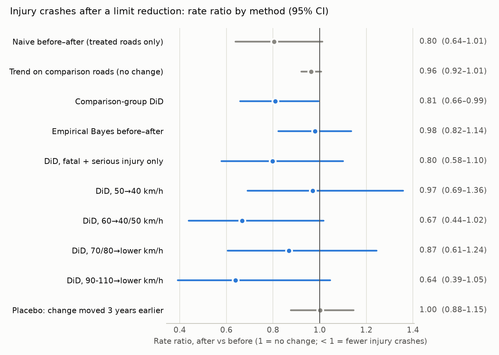
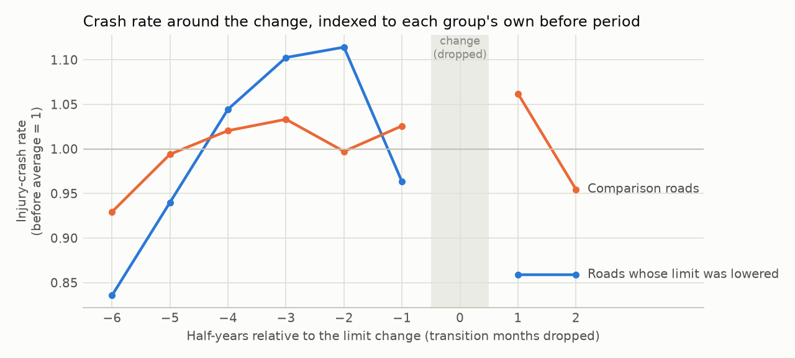

# Did lowering speed limits reduce injury crashes? A spatial before–after evaluation on Victorian open data

[](https://github.com/zeussilver/road-safety-eval/actions/workflows/ci.yml)

**[2-page policy brief](docs/BRIEF.md)**

<!-- Generated by `make report` from docs/templates/README.md.tmpl. Every number below is read from
     outputs/metrics.json, which the pipeline writes; edit the template, not this file. -->

Between 2023-06 and 2026-09, 9,485 Speed Zones features in Victoria had their posted limit lowered. This
project asks a narrow, answerable question with open data only:

> On road segments whose limit was **lowered** between mid-2023 and end-2024, did police-reported **injury
> crashes** change, compared with similar segments whose limit did **not** change?

It is an observational evaluation. It can say how crashes moved on treated roads relative to comparable
roads. It cannot prove the limit change caused that movement.

## Key results

| | Rate ratio after vs before (95% CI) |
|---|---|
| Naive before–after, treated roads only | 0.80 (0.64–1.01) |
| Trend on comparison roads | 0.96 (0.92–1.01) |
| **Comparison-group difference-in-differences (main)** | **0.81 (0.66–0.99)** |
| Same DiD, fatal + serious injury crashes only | 0.80 (0.58–1.10) |
| Empirical Bayes before–after (fails its placebo, see below) | 0.98 (0.82–1.14) |
| Placebo: same DiD with the change moved 3 years earlier | 1.00 (0.88–1.15) |

- **Sample.** 1,109 treated road segments (777 km, 206 change requests)
  versus 271,949 never-changed segments. 836 treated segments (638 km) fall in strata that
  inform the estimate. They had 516 injury crashes in the 36 months before the change and 191 afterwards
  (12–27 months, to 2025-12).
- **Main estimate.** Injury crashes on treated roads were **19% lower** than the comparison-road trend
  predicts. The rate ratio is 0.81, with a 95% CI of 0.66–0.99 (between 1% and 34% fewer). The evidence is modest:
  in 3 of 8 sensitivity analyses the interval reaches 1 (no change). Point estimates
  range from 0.70 to 0.86.
- **By type of change.** The clearest reductions are on roads lowered from 60 km/h and from 90–110 km/h,
  but each subset alone is inconclusive. Local streets lowered from 50 to 40 km/h show no clear change
  over this short follow-up.
- **Checks.** The placebo (fake change three years earlier) returns 1.00, so treated and comparison
  roads moved together before the change. Varying the before window from 12 to 60 months keeps the
  estimate between 0.78 and 0.80 (main analysis, 36 months: 0.81). If regression to the mean were
  driving the result, short windows would show bigger reductions.
- **Why the comparison group matters.** In the placebo period, a naive before–after count says crashes on
  these roads rose 13% (1.13). The rise came from the post-lockdown rebound, which
  comparison roads also show (1.15). The DiD correctly reports no change.
- **Empirical Bayes fails its own placebo** (1.18, 1.04–1.32, with no real change). Its
  safety performance function has no current traffic volumes (open AADT stops in 2019), so it cannot tell a
  busy road from an unlucky one and over-corrects. The main estimate is therefore not based on EB.
- **Yarra 30 km/h trial (case study).** Injury crashes on the trial streets went from 157 in 40 months
  to 58 in 19 months. The DiD rate ratio is 0.72 (0.50–1.02, p = 0.07). The study is
  underpowered: it would detect a true 20% reduction only 27% of the time.



Interactive map: [`outputs/map.html`](outputs/map.html) shows treated segments by type of change, injury
crashes before and after, and the Yarra trial and comparison streets.

## Data

All open, CC BY 4.0, Victorian Government (Department of Transport and Planning; Vicmap). Verified on the
portals on 2026-10-19.

| Dataset | Used for |
|---|---|
| [Victoria road crash data](https://discover.data.vic.gov.au/dataset/victoria-road-crash-data): `accident`, `node`, `accident_location` | 202,297 crashes, 2012-01-01 to 2026-02-28; outcome, location, police-coded speed zone |
| [Speed Zones](https://discover.data.vic.gov.au/dataset/speed-zones): 14 of the monthly snapshots (Nov 2021, then roughly quarterly Jun 2023 → Sep 2026) | 6,587,787 features, 6.7 GB of GeoJSON → 419 MB of Parquet; posted limit over time |
| [Historical AADT 2019](https://discover.data.vic.gov.au/dataset/historical-annual-average-daily-traffic-volume) | declared (arterial) road flag and 2019 volume; no data after 2019 |
| Vicmap Admin LGA and locality polygons (WFS) | LGA of each segment; Fitzroy / Collingwood boundaries |

### Data-quality findings (each one changed the design)

- **Crash data is complete only to 2025-12.** The file runs to 2026-02-28, but Jan and Feb 2026 hold only
  138 and 90 crashes, against 1,122 in Dec 2025. The study ends at 2025-12.
- **`node.csv` repeats rows.** It has 407,410 rows for 201,003 located crashes, and 3,148
  crashes carry two different urban-area labels. Locations are deduplicated to one row per crash;
  1,294 crashes have no location.
- **Coordinates are GDA94, including Speed Zones.** Projecting crash lat/lon as GDA94 reproduces the
  file's own VicGrid94 metres to a median 0.37 m (GDA2020: 1.59 m). Speed Zones GeoJSON is
  untagged. Read as GDA2020, crashes sit a median 0.86 m off their road; read as GDA94, the median
  is 0.17 m.
- **Speed Zones ids are stable from Jun 2023.** All 470,175 base features persist. Between
  2023-06 and 2026-09, 9,977 features changed limit: 9,485 decreases and 492 increases.
  Diffing snapshots therefore finds treatments directly. The fallback of inferring changes from crash
  records was not needed.
- **The January 2024 snapshot on the portal is corrupt.** Four separate downloads came back with large
  zero-filled sections. Nov 2023 and Feb 2024 bracket it instead, and the downloader now rejects any file
  containing NUL bytes.
- **Roads are stored once per direction.** Collapsing identical geometries gives 287,966 carriageway units
  (251,354 km). Arterials keep two units, because their directional lines differ slightly
  (45,316 km flagged as declared).
- **The Yarra 30 km/h expansion is not in Speed Zones.** Police crash records do show it, so the case study
  defines treatment from the council's published scope.

## Method

```
download → ingest → network → treatment → snap → evaluate → yarra → report        (make all)
```

1. **Ingest** (DuckDB, pyogrio): crash CSVs → Parquet. Each snapshot → slim attribute Parquet (limit,
   conditions, change-request id, geometry hash). Full geometry is kept for the base snapshot only.
2. **Network** (GeoPandas, EPSG:7855 GDA2020 / MGA55): carriageway units; LGA by point-in-polygon; declared
   road if 2 of 3 points along the unit lie within 15 m of the AADT network; Nov 2021 limit at the unit
   midpoint (99.99% matched within 5 m).
3. **Treatment.** Treated: exactly one decrease, first seen in a Sep 2023 to Dec 2024 snapshot, with Normal
   Operation conditions throughout and no other change up to Jan 2026. Comparison: no change in any
   snapshot from Nov 2021 to Jan 2026. Exclusions: 8,624 school/shop/seasonal zones (they store
   the lowest limit of the day); 2,422 changed outside the window; 810 changed between Nov
   2021 and Jun 2023; 254 increases; 2,798 other. The implementation month is known only to lie
   between two snapshots. Those months are dropped as a transition period.
4. **Snapping.** Every unit within 30 m is a candidate. Candidates within 2 m of the nearest are a near-tie
   (intersections, two-direction arterials). A near-tie goes to the unit whose limit at the crash date
   matches the police-recorded speed zone, otherwise to the nearest. 99.8% of located crashes match
   (intersections 99.9%, midblock 99.8%), at a median distance of 0.2 m (95th percentile
   0.8 m). Police speed zone agrees with the posted limit for 77% of crashes since Jun 2023 on
   normal segments and 48% on time-of-day zones.
5. **Evaluation (stacked DiD).** Each first-seen snapshot is a cohort with its own windows: 36 months before,
   the transition dropped, then after to 2025-12. Comparison units come from the same stratum: original
   limit × declared/local × LGA, falling back to metro/regional when an LGA has fewer than 30 comparison
   units. The estimator is a Poisson model with unit fixed effects. With two periods it is fitted exactly as a
   binomial GLM on each unit's after-share of crashes, with cohort × stratum effects (`statsmodels`).
   A cell-level Poisson GLM gives the same point estimate (0.81) as a cross-check, and a unit test
   asserts the equivalence. Standard errors are cluster-robust three ways (scheme/LGA, unit, LGA) and the
   **largest** is reported. Some subsets have few, very unequal clusters, where one clustering understates
   the uncertainty.
6. **Empirical Bayes** (Hauer): a safety performance function on comparison units (limit, declared, metro,
   log length), NB overdispersion by moments, and the comparison-group trend for the after period.

### Results in detail

Cohorts (treated units, windows, injury crashes before / after):

| First seen | Units | Before | After | Crashes |
|---|---|---|---|---|
| 2023-09 | 36 | 2020-07..2023-06 | 2023-10..2025-12 | 19 / 19 |
| 2023-11 | 21 | 2020-10..2023-09 | 2023-12..2025-12 | 14 / 2 |
| 2024-02 | 63 | 2020-12..2023-11 | 2024-03..2025-12 | 6 / 7 |
| 2024-03 | 35 | 2021-03..2024-02 | 2024-04..2025-12 | 16 / 5 |
| 2024-06 | 492 | 2021-04..2024-03 | 2024-07..2025-12 | 196 / 81 |
| 2024-09 | 208 | 2021-07..2024-06 | 2024-10..2025-12 | 154 / 47 |
| 2024-12 | 254 | 2021-10..2024-09 | 2025-01..2025-12 | 112 / 30 |

By type of change. Each row is its own stacked DiD, so units and crashes count only the strata used.
The placebo column moves the change 3 years earlier, where the true effect is none:

| Change | Units | Crashes before / after | Naive | DiD | EB | DiD placebo |
|---|---|---|---|---|---|---|
| 50→40 | 341 | 116 / 52 | 0.91 (0.67–1.24) | 0.97 (0.69–1.36) | 1.18 (0.81–1.56) | 1.05 (0.74–1.50) |
| 60→40/50 | 135 | 100 / 27 | 0.65 (0.43–0.97) | 0.67 (0.44–1.02) | 0.60 (0.36–0.84) | 1.04 (0.75–1.45) |
| 70/80→lower | 266 | 209 / 84 | 0.88 (0.57–1.36) | 0.87 (0.61–1.24) | 0.97 (0.73–1.20) | 1.07 (0.82–1.38) |
| 90-110→lower | 94 | 91 / 28 | 0.65 (0.40–1.07) | 0.64 (0.39–1.05) | 0.81 (0.47–1.14) | 0.81 (0.62–1.05) |

The 90–110 km/h placebo also sits below 1, so part of that subset's reduction may be a pre-existing trend.

Before-window crash rate (injury crashes per km-year), treated versus the comparison units in their strata.
These differences are why unit fixed effects and the placebo matter more here than covariate matching:

| Change | Treated | Comparison | Ratio |
|---|---|---|---|
| 50→40 | 0.32 | 0.10 | 3.3× |
| 60→40/50 | 0.43 | 0.56 | 0.8× |
| 70/80→lower | 0.38 | 0.41 | 0.9× |
| 90-110→lower | 0.08 | 0.02 | 4.7× |

Sensitivity of the main DiD:

| Variant | Rate ratio (95% CI) | Treated crashes before / after |
|---|---|---|
| buffer 15 m | 0.83 (0.68–1.01) | 516 / 191 |
| buffer 50 m | 0.80 (0.65–0.99) | 516 / 191 |
| midblock crashes only | 0.70 (0.54–0.91) | 299 / 94 |
| transition padded 3 months each side | 0.86 (0.70–1.06) | 513 / 161 |
| region strata only | 0.82 (0.65–1.02) | 517 / 191 |
| 12-month before window | 0.80 (0.64–1.00) | 179 / 190 |
| 24-month before window | 0.78 (0.64–0.96) | 364 / 190 |
| 60-month before window | 0.80 (0.67–0.97) | 841 / 191 |



The event-time plot shows treated roads rising faster than comparison roads in the 1–2 years before the
change. If schemes had been triggered by that rise, short before windows would show larger reductions than
long ones. The before-window rows above show they do not.

### Yarra 30 km/h case study

Treated: 363 units (63.4 km), every 40/50 km/h street in Fitzroy and Collingwood that was
unchanged in Speed Zones, excluding Johnston St, Nicholson St, Hoddle St, Alexandra Pde and Victoria Pde.
Comparison: 2,374 units (424.6 km) of the same kind in 9 neighbouring suburbs. Before 2021-01 →
2024-04, after 2024-06 → 2025-12.

| | Before (40 months) | After (19 months) |
|---|---|---|
| Trial streets | 157 | 58 |
| Comparison streets | 528 | 272 |

Naive 0.78 (0.57–1.06); DiD 0.72 (0.50–1.02). Police coded 30 km/h on
2% of crashes on these streets before the trial and 40% after (23 of
58), so the new limit was in force but not recorded on every crash. Simulated power for a true 20%
reduction is 27% (40% reduction: 83%). The point estimate is consistent with a meaningful
reduction, but this sample cannot confirm it.

## Limitations

- **Observational.** Limit changes are not random. They often come with other works (signs, traffic calming,
  road upgrades) that the data does not record. The estimate covers the whole package.
- **Implementation dates** are known only to within a snapshot interval, and the database may lag the signs.
  Padding the transition by 3 months each side gives 0.86 (0.70–1.06).
- **No current exposure.** Open AADT ends in 2019 and covers declared roads only. Exposure is length × time,
  so a change in traffic on treated roads alone would bias the result.
- **Short follow-up.** 12–27 months after the change. Fatal and serious crashes are too few to stand alone.
- **Snapping** at intersections relies on the police speed-zone code to break near-ties. The midblock-only
  run (0.70 (0.54–0.91)) avoids that rule.
- **Recent crash records are provisional** and can be amended.
- EPSG:7855 (MGA zone 55) slightly stretches distances in far-west Victoria, which lies outside zone 55.
  That is irrelevant at a 30 m buffer.

## What connected-vehicle data would add

No connected-vehicle data is public, and none is simulated here. With operating speeds per segment over
time, the same units and windows would answer the first-order question (did speeds drop?). They would also
supply the missing exposure term, which is exactly what made the EB estimate unreliable here.

## Reproduce

```bash
make all      # creates .venv (uv or venv), downloads the data (6.7 GB of snapshots), runs every step
make test     # pytest: snapping, windows, treatment detection, estimator equivalence
```

Set `SNAPSHOTS=monthly` to use every Speed Zones snapshot on the portal. `make clean` keeps the raw files.

```
src/rse/      config, download, ingest, network, treatment, snap, windows, evaluate, yarra, report
tests/        synthetic fixtures, no downloads
outputs/      metrics.json (every number), facts.json, tables/*.csv, figures/*.png, map.html
docs/         PLAN.md, BRIEF.md (policy brief), templates/ (README and BRIEF are rendered from these)
```

## Attribution

Contains data from the Victorian Government (Department of Transport and Planning; Vicmap), licensed
under CC BY 4.0. Analysis by Zhenqian Liu. Findings are the author's own and do not represent DTP.
